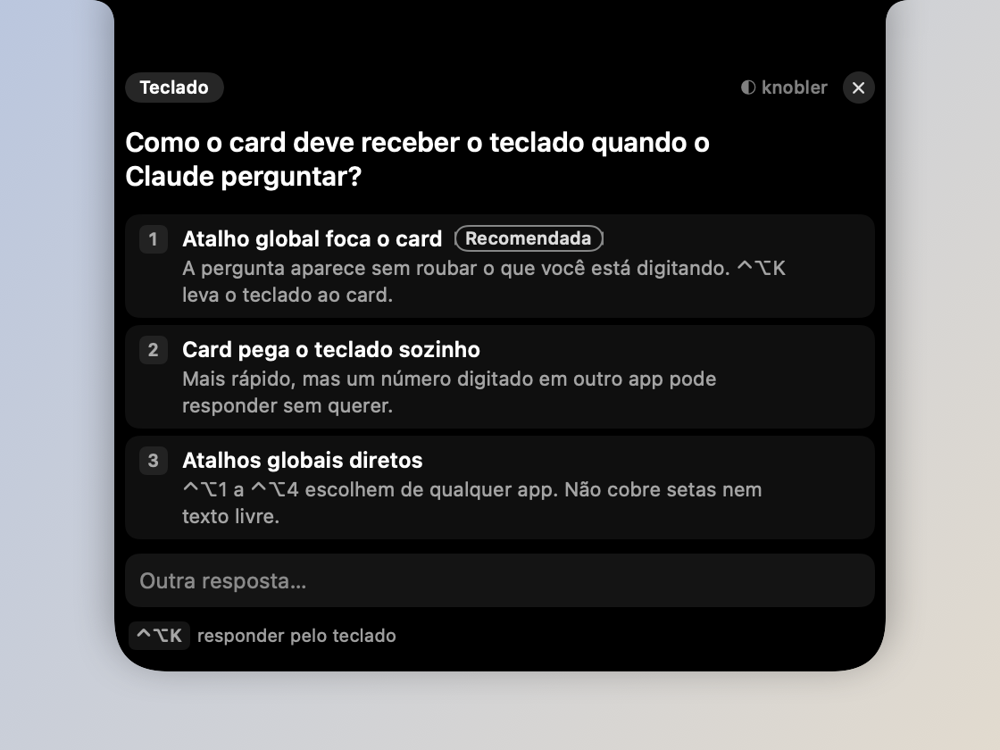
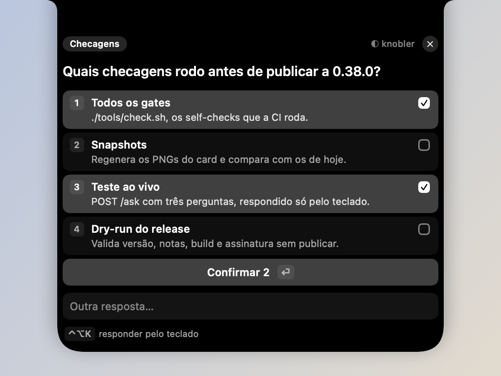

# Perguntas do Claude Code (Ask)



*Pergunta de escolha única, com a opção recomendada pelo Claude.*



*Múltipla escolha.*

## O que faz

Quando o Claude Code usa a ferramenta `AskUserQuestion` (por exemplo, num hook
`PreToolUse`), a pergunta aparece como um card no notch em vez de ficar só no
terminal, com opções de escolha única ou múltipla e um campo "Outra resposta".
Responder no card devolve a resposta pro Claude via o mesmo hook que publicou a
pergunta.

A pergunta chega **sem roubar o teclado**: o que você digita continua indo pro
app em que você estava. A pergunta, as descrições das opções e o preview saem
sempre inteiros.

## Como usar

- Não exige ação manual do lado do Knobler: um hook `PreToolUse` do seu
  projeto Claude Code publica a pergunta via `POST /ask` na API local
  (ver `docs/local-api.md`); o card aparece sozinho.
- Com o mouse: clique na opção (pergunta simples responde na hora; na múltipla
  escolha, marque as opções e clique em **Confirmar**).
- Pelo teclado: com a pergunta na tela, o atalho do notch (⌃⌥K por padrão,
  configurável em Ajustes › Notch) dá o teclado ao card. Apertar de novo solta
  o teclado, que volta pro app da frente, e o card continua na tela. Clicar no
  campo "Outra resposta" também dá o teclado ao card. Sem o teclado, o rodapé
  mostra o atalho; com ele, a legenda das teclas.

Com o teclado no card:

| Tecla | Efeito |
|---|---|
| `↑` `↓` | move o destaque entre as opções |
| `1`…`9` | escolhe a opção daquele número (pergunta simples: responde; múltipla: marca/desmarca) |
| `⏎` | pergunta simples: responde com a opção em destaque; múltipla: confirma as marcadas |
| `espaço` | múltipla: marca/desmarca a opção em destaque |
| `←` `→` | troca de aba (pergunta anterior/seguinte), quando há mais de uma |
| `⇥` | leva o cursor ao campo "Outra resposta"; `⇧⇥` volta à lista |
| `esc` | no campo de texto, volta à lista; na lista, solta o teclado (o card fica) |
| `⌘.` | cancela a pergunta, igual ao ✕ (ela volta para o terminal) |

Os números valem pelo caractere digitado, então funcionam no teclado numérico e
em qualquer layout. Opções além da nona não têm número; setas e mouse alcançam.

O ✕ no canto do card cancela a pergunta, que volta para o terminal.

### Várias perguntas: abas

Com mais de uma pergunta na mesma rodada, o topo do card vira uma fileira de
abas, uma por pergunta, cada uma marcada como pendente, atual ou respondida (com
✓ e a resposta resumida). Dá para voltar a uma aba já respondida, pelo clique ou
por `←` `→`: a resposta aparece marcada e responder de novo substitui a
anterior. Responder leva à próxima aba pendente; quando não sobra pendente, a
rodada é enviada na hora, sem tela de revisão. Marcações não confirmadas e texto
não enviado se perdem na troca de aba.

### Opção recomendada e preview

Uma opção cujo rótulo termina em `(Recomendado)` ou `(Recommended)` aparece sem
o sufixo e com o selo **Recomendada**; a resposta enviada ao Claude usa o rótulo
original.

Quando a opção traz um preview (texto monoespaçado), ele acompanha a opção em
destaque e sai sempre inteiro: o card alarga até caber ao lado das opções; se
não couber, o preview desce para baixo da lista; se ainda assim não couber, a
letra encolhe até 8 pt, e só abaixo disso o preview rola.

### Tamanho do card

O card cresce até 60% da distância entre o topo da tela e o Dock. Acima disso,
só a lista de opções rola por dentro; pergunta, abas, campo de texto e legenda
ficam fixos. O preview pode levar o card além desse teto, até o Dock.

### Pergunta durante a digitação

Se você está digitando no notch (nota rápida, agenda, lembretes), a pergunta
não toma o card: ela espera, e o card em uso ganha no topo o selo "Claude
perguntou". A pergunta abre quando você sai do campo (Esc, clique fora) ou
clica no selo, sempre sem pegar o teclado, e o rascunho do campo não se perde.

Para instalar o hook globalmente no Claude Code:

```bash
./tools/claude-hook/install.sh
```

Ele passa a valer na próxima sessão do Claude Code. O hook não torna o Ask
obrigatório: se o Knobler estiver desligado, a pergunta continua no terminal.

O instalador **copia** os scripts para `~/.claude/hooks`; atualizar o Knobler
não mexe neles. Depois de atualizar o repositório, rode o `install.sh` de novo
para levar as correções dos hooks (como a espera numa conexão só, em vez de
perguntar ao app três vezes por segundo).

## Permissões do Claude

O instalador também registra o hook nativo `PermissionRequest`. O pedido mostra
ferramenta, detalhes e sugestões no NOB, sem executar comandos. **Permitir**
aprova só a operação atual. **Permitir na sessão** só cria regras em memória
para a sessão atual; não grava permissões persistentes. Se a API ou o token não
estiverem disponíveis, o hook não devolve decisão e Claude mantém o prompt
nativo no terminal.

## Contrato e ciclo de vida

O fluxo usa a API local documentada em [`docs/local-api.md`](local-api.md):

1. o hook gera um ID e faz `POST /ask`;
2. o Knobler enfileira a pergunta no `AskStore` compartilhado por todos os
   monitores;
3. a resposta ou o cancelamento é enviado ao servidor;
4. o hook espera em `GET /ask/<id>` com long-poll (`X-Knobler-Wait`, ver
   [`local-api.md`](local-api.md#long-poll-x-knobler-wait)) até obter uma
   resposta, cancelamento ou falha de comunicação.

O primeiro resultado vence. Respostas são consumidas uma única vez; perguntas
órfãs expiram após 15 minutos. Desligar a API limpa a apresentação e invalida
callbacks antigos.

Para desenvolvedores, `AskReducer` é a lógica pura de estado e
`AskStore` é o runtime `@MainActor` que executa os efeitos de resolve/cancel.
O reducer não conhece HTTP, AppKit ou SwiftUI. O mapa completo está em
[`docs/architecture.md`](architecture.md).

## Permissões

Nenhuma permissão especial — só a API local (`127.0.0.1:4477`), que não
exige permissão de sistema.
